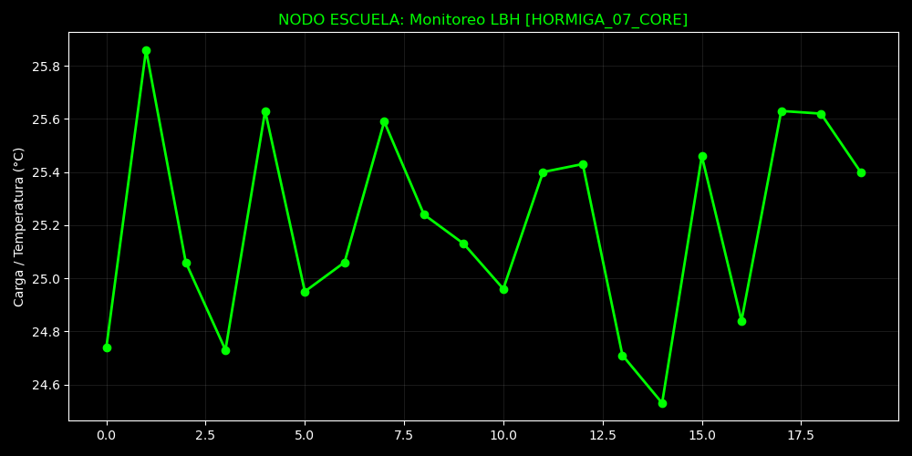

# 🐜 xoxo-lbh-adapter
🛡️ **Puente de Inteligencia Distribuida Soberana**

Este repositorio actúa como el Adapter visual de la Colonia HormigasAIS. 
Los datos aquí presentados son validados por el **Nodo Escuela** bajo protocolo LBH.

### 📊 Pulso en Tiempo Real (Hormiga 07)

### ⚙️ Estado del Sistema
- **Protocolo:** LBH SOBERANO
- **Firma Raíz:** Cristhiam Leonardo Hernández Quiñonez (CLHQ)
- **Estado:** ✅ ANTIFRÁGIL

---
*San Miguel, El Salvador | 2025-12-28*
